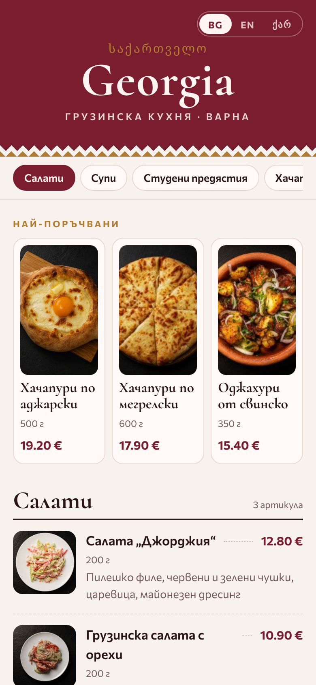
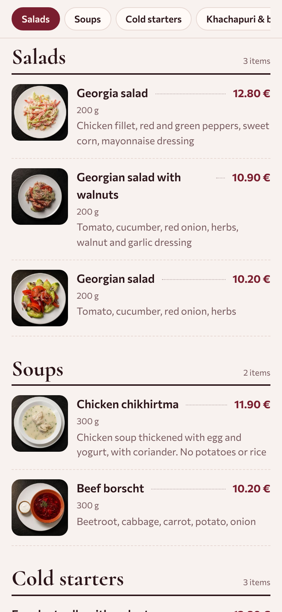
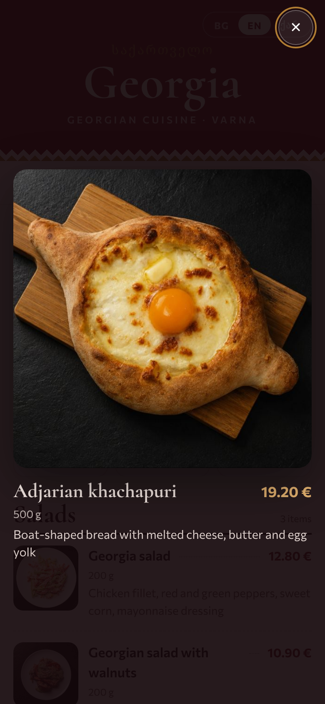
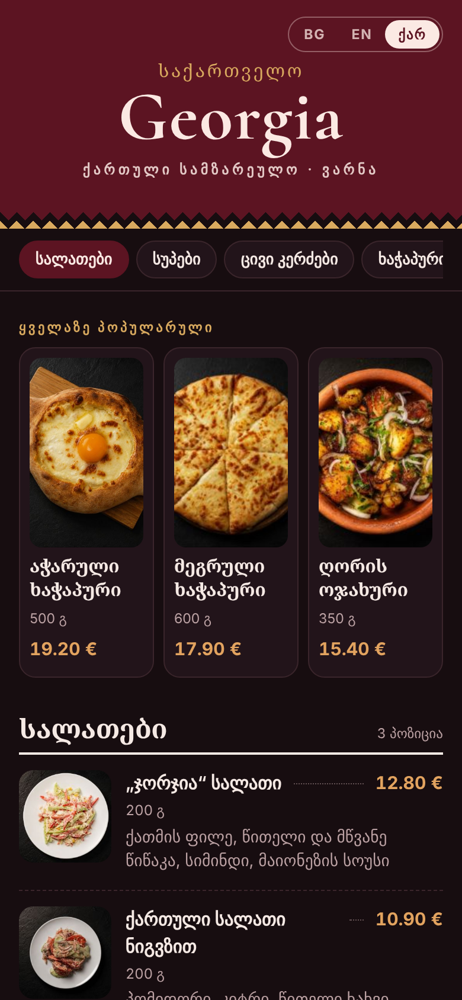

# Restaurant Georgia – Digital Menu

A mobile-first digital menu for **Restaurant Georgia**, a Georgian restaurant in Varna, Bulgaria.
Guests tap the NFC stand or scan the QR code on their table, and the menu opens on their phone, with no app to install.

**Live demo:** https://georgia1.zeminmedia.workers.dev

<p>
  
  
  
  
</p>

## Features

- **3 languages:** Bulgarian, English and Georgian. The menu picks the language from the phone's settings and remembers the guest's choice.
- **Sticky category bar:** it follows the scroll and highlights the section the guest is reading.
- **Bestsellers strip** at the top, with the most ordered dishes.
- **Tap a photo to enlarge it,** with the dish name, price, weight and description. Closes with ×, Esc or the phone's back button.
- **Dark mode:** follows the phone's light/dark setting automatically.
- **Fast and light:** a single HTML file with no frameworks and no build step. Photos are lazy-loaded.
- **Accessible:** semantic HTML, keyboard focus styles, reduced-motion support, iPhone notch safe areas.

## Tech

- HTML, CSS and vanilla JavaScript (one file)
- Google Fonts: Cormorant, Commissioner, Noto Serif Georgian
- Hosted on **Cloudflare Workers** (static assets)
- Printed **NFC + QR table stand** designed to match the menu

## Project structure

```
index.html            Menu page: layout, styles, menu data and logic
img/                  Dish photos
favicon.ico           Browser tab icon
favicon-512.png
apple-touch-icon.png  Home-screen icon on iPhone
screenshots/          Images used in this README
```

The menu content lives in the `MENU` array in `index.html`. To change a price or add a dish, edit that array.

## Credits

Designed and delivered by **Muhammed Selim**: concept, UI design,
menu content in 3 languages, the printed NFC/QR table stand, client communication
and deployment. The code was written with AI assistance (Claude).
Dish photos belong to Restaurant Georgia.
